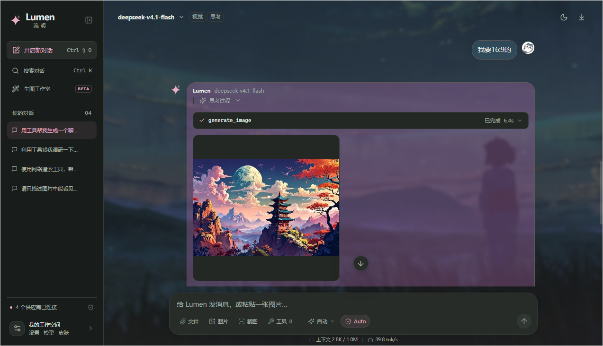
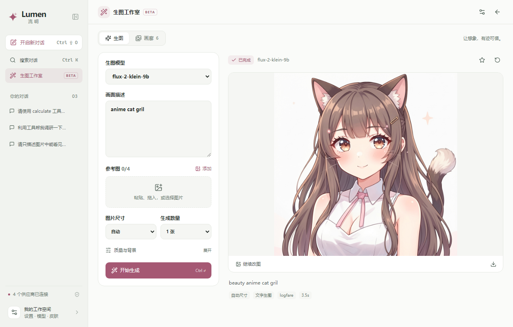
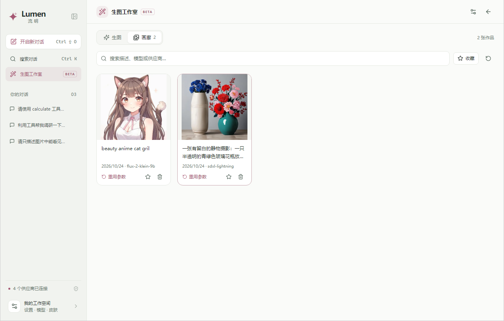
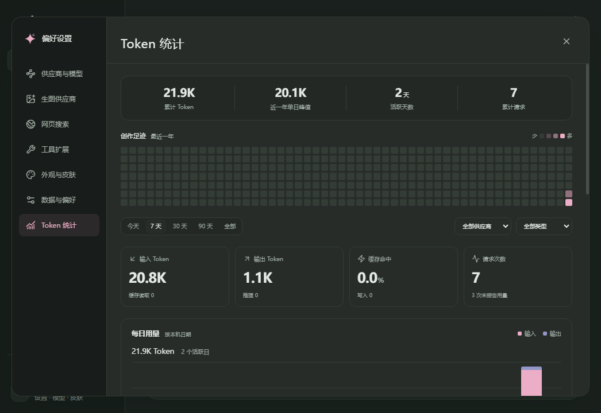

# Lumen · 流明

把聊天、工具和生图放进 uTools。

Lumen 是一个轻量的 BYOK AI 工作空间：连接自己的供应商和模型，粘贴图片开始对话，让 Agent 搜索、计算或生成图片，再把作品留在本地画廊。安装后的插件即开即用，无需常驻开发服务。

**0.2.4 Beta** · uTools 插件市场审核中 · [版本与下载](https://github.com/Saktawdi/utools-lumen/releases) · [问题反馈](https://github.com/Saktawdi/utools-lumen/issues) · [MIT License](LICENSE)



## 功能一览

| 功能            | 可以做什么                                                                         |
| --------------- | ---------------------------------------------------------------------------------- |
| 多模型 BYOK     | 自定义供应商、API 地址和密钥；拉取、筛选、复选或框选启动模型，在聊天中自由切换。   |
| 图片与附件      | 粘贴、拖放、选图或截图提问；添加文本与代码文件，交给 Agent 读取。                  |
| Agent 工具      | 搜索网页、读取内容、计算、查时间、发现附件；按需扩展本地或 HTTP 工具。             |
| 生图工作室      | 独立配置生图供应商，文字生图、参考图改图；Agent 也能调用 `generate_image`。        |
| 本地画廊        | 集中查看工作室和 Agent 的作品，支持搜索、收藏、复制、下载和继续改图。              |
| Token 统计      | 会话上下文占用与输出速率；偏好设置中查看活动热力图、用量趋势、模型分布和请求明细。 |
| 外观定制        | 浅色、深色、跟随系统；本地背景、高斯模糊、自定义头像、气泡样式和紧凑布局。         |
| uTools 快捷指令 | 选中文字翻译、截图翻译、选中文字问答，使用你设置的默认 Agent。                     |

## 快速开始

1. 在 uTools 搜索 **Lumen** 或 **流明**，打开左下角「我的工作空间」。
2. 在「供应商与模型」添加 API 地址和密钥，选择对应协议，点击「拉取模型」。
3. 勾选常用模型加入启动列表，回到聊天，在顶部选择模型并发送消息。
4. 按需配置「生图供应商」「网页搜索」，或在「数据与偏好」指定默认 Agent、翻译目标语言和发送方式。

支持 **OpenAI Chat、OpenAI Responses、Anthropic Messages、Google Gemini** 四种聊天协议；兼容网关请选择其实际实现的协议。BYOK 表示使用自己的 API 密钥，模型、生图和搜索服务所需额度及费用由相应服务商决定。

## 模型与 Agent

启动模型列表支持复选、文本筛选、筛选结果全选和拖动框选，按住 `Shift` 可追加选择。模型能力自动匹配 [models.dev](https://models.dev) 的视觉、工具、上下文和推理参数，兼容渠道前缀、命名空间、日期及推理档位后缀；完整模型身份与手动设置优先，请求保留供应商原始模型 ID。

可以调整推理强度，也可以输入上游支持的自定义值。模型配置中的推理档位支持中英文逗号、分号、回车和多行粘贴分割，并自动去空、去重。实际支持的参数以供应商接口为准。

Agent 通过 `list_tools` 发现已注册能力，内置时间、计算、网页搜索与读取、附件发现与读取，以及生图工具 `generate_image`。可按需启用工具，开发者也能注册本地工具或 HTTP 工具。

输入框中可单击切换 **「每次询问 / Auto」**。默认逐次确认需授权的工具调用；Auto 自动允许，等待中的调用也会继续。模式会保留，已关闭的工具不会被 Auto 启用。

网页搜索支持 **AnySearch 官方 MCP、Tavily、SearXNG 和自定义 JSON 搜索**，配置页可直接测试。聊天供应商、生图供应商及搜索服务均支持批量导入多个密钥、去重、轮询与失败切换。

日常对话支持流式回复、思考过程与工具状态展示、停止、重试、编辑重发、历史搜索、置顶、重命名及 Markdown 导出。

## 生图工作室与画廊



打开侧栏「生图工作室」，在「偏好设置 → 生图供应商」添加连接、密钥和模型。支持 **OpenAI Images 兼容接口**与 **Google Gemini 原生生图接口**，可复制已有聊天供应商的连接，再独立调整。

选择模型并输入画面描述，按需粘贴、拖放或选择参考图，设置尺寸、数量、质量与背景。可用参数随模型能力匹配；生成期间可以停止，也可以切回聊天继续使用。模型是否支持生图或改图，仍以其供应商接口为准。



工作室和 Agent 生成的作品自动进入本地画廊，可搜索、收藏、预览、复制、下载、重用参数和继续改图。`generate_image` 使用独立的生图配置，并遵循输入框中的工具权限模式；调用时向配置的生图供应商发送描述及选定的参考图。

删除画廊记录会删除对应的本机图片，聊天内的关联图片也会失效。

## Token 与用量统计



聊天输入框下方用一行展示上下文占用和 `tok/s` 输出速率，悬停可查看详细数值；上下文环形图结合当前模型的上下文上限显示占用。尚无供应商用量回报时，上下文会标为估算。

进入「偏好设置 → Token 统计」，查看累计 Token、近一年活动热力图、每日趋势、模型分布及最近请求。支持今天、7 天、30 天、90 天或全部记录，按供应商和聊天／生图类型筛选，并导出当前筛选的 CSV。

历史统计使用供应商返回的用量字段，每轮 Agent 请求单独计数。缓存读取与推理是输入或输出的子集，不重复叠加；未报告用量的请求会明确标记，停止或失败的请求仅保留已报告的数据。统计独立保留，删除聊天或图片不会删除历史用量；页面不估算价格或供应商账单。

## 外观与皮肤

浅色、深色和跟随系统模式，内置 **青岚、远山、暖砂、绯雾** 四款皮肤。聊天默认双侧排列、用户在右，也可切为单侧；用户和 Agent 的头像都支持本地图片。

在「外观与皮肤」中点击「以此为基础定制」或「自定义皮肤」，可以添加本地背景，调整高斯模糊、图片显隐和位置，选择柔和、描边或简约气泡，并设置圆角、不透明度及浅深色配色。即时预览支持独立切换浅深色，皮肤可导入导出为 JSON。

紧凑布局会同步收紧气泡留白、消息间距、段落与行距，预览即时变化；也可开启「减少动态效果」。外观与偏好自动保存。

头像与背景在导入时保存为缩放后的静态副本，属于本地外观设置，不作为聊天附件发送给模型。皮肤导出包含背景图，完整配置备份还包含双方头像。

## uTools 快捷指令

| 指令       | 行为                                                                 |
| ---------- | -------------------------------------------------------------------- |
| AI翻译     | 选中文字后从超级面板选择，自动发送翻译；直接打开后粘贴文字也会发送。 |
| AI截图翻译 | 框选区域，截图复制到剪贴板并自动发送翻译；也支持 uTools 图片入口。   |
| AI问答     | 选中文字后自动咨询；直接打开后粘贴文字也会发送。                     |

在「数据与偏好」中指定默认 Agent 和翻译目标语言。默认目标 `cn`（简体中文），也支持语言代码或自定义语言名称。快捷指令每次新建对话；截图翻译需要支持图片的默认模型。聊天输入框也提供「截图」按钮，截取后作为附件发送。

快捷键：`Ctrl+K` 搜索对话，`Ctrl+Shift+O` 新对话，`Ctrl+,` 打开设置，`Esc` 关闭浮层。发送方式可在设置中切换。

## 本地安装

需要 **uTools 8**。在「uTools 开发者工具」中新建插件项目，选择「导入源码工程」，导入构建目录的 `plugin.json`，再「接入开发」并运行。

运行 `npm run package` 可生成 `release/lumen-0.2.4-local.zip`，解压后的 `Lumen/plugin.json` 是导入入口。该构建包不需要 Node 环境，也不包含个人配置。发行文件见 [GitHub Releases](https://github.com/Saktawdi/utools-lumen/releases)。

如需 `.upxs`，请在 uTools 开发者工具中使用「构建离线安装包」。当前为 **0.2.4 Beta**，uTools 插件市场仍在审核，审核通过前可从 GitHub 下载本地导入包。开发模式下的超级面板等入口受宿主限制。

修改 preload 后需要完全退出插件再打开，普通页面重载不能重新加载 Node 桥接。

## 开发

Node.js 22.12+：

```sh
npm ci
npm run dev
npm run check
npm run test:native
npm run package
```

`dev` 用于浏览器开发，监听 `127.0.0.1:5178`；安装后的插件直接使用 preload。开发服务器默认使用当前用户的本地配置，隔离验证时请设置 `LUMEN_DATA_DIR`。

Windows 可双击 `start-local.cmd` 启动浏览器版本，首次运行会安装锁定的开发依赖；关闭该命令窗口即停止服务。生图等功能与插件共用运行时，可独立于 uTools 开发和测试。修改 `runtime/` 后需重启开发服务器；页面样式和组件支持热更新。

`test:native` 在 ESM 入口中加载实际构建的 preload，验证模块边界、存储、权限模式和工具初始化，同时模拟宿主拒绝创建 Worker。`dist/package.json` 必须随插件保留，避免继承根工程的 ESM 模式。

工程结构：`src/` 界面与状态，`runtime/` 协议、网络、工具和存储，`scripts/` 构建与维护，`tests/` 核心回归，`assets/screenshots/` 文档展示图。模型匹配逻辑维护在 `src/model-catalog.ts`，开发与构建时同步生成原生运行时，测试校验两端一致。

## 数据与备份

Windows 数据目录为 `%APPDATA%\uTools\lumen`。供应商、密钥与聊天使用 AES-256-GCM 存储，写入时保留上一版 `.bak`。`vault.key` 是同目录中的本机解密密钥，备份整个目录时需一并保存。

JSON 备份默认不含聊天／生图供应商、搜索和 HTTP 工具的密钥或请求头。恢复这种备份会保留当前相同 ID 的密钥，并合并供应商和聊天；开启「导出时包含密钥」后，备份文件包含明文凭据。聊天内容会原样导出。

画廊原图、参考图、缩略图与 Token 统计独立加密保存在同一数据目录中，未包含在配置与会话 JSON 备份内。聊天中的生成图片记录保存本机图片 ID；跨设备恢复需要连同完整数据目录与 `vault.key` 一起迁移。

模型请求发送给选定供应商，搜索请求发送给配置的搜索服务，网页和 HTTP 工具请求发送给目标地址。Lumen 没有自己的遥测或中转服务。详细说明见 [隐私说明](PRIVACY.md)。

## 参考与许可

模型管理与参数配置交互参考 [opentreelearn](https://github.com/Saktawdi/opentreelearn)，独立实现。能力元数据来自 [models.dev](https://models.dev)，仅辅助设置，实际能力以供应商为准。

Token 统计的信息组织参考 [ZCode](https://github.com/zai-org/ZCode) 的开源用量页面，独立实现，无新增图表依赖。模型身份匹配参考其 [Provider Registry](https://github.com/zai-org/ZCode/blob/main/apps/zcode-cli/packages/bootstrap/src/app/provider-registry-selection.ts) 与[模型引用解析](https://github.com/zai-org/ZCode/blob/main/apps/zcode-cli/packages/core/src/tool/handlers/model-reference.ts)，增加中转服务命名兼容，并保留有歧义的能力供手动配置。

当前宿主验证平台为 Windows / uTools 8.0.1，macOS 与 Linux 尚未进行宿主实测。

项目使用 [MIT License](LICENSE)，本地构建包附有生产依赖许可证清单 `THIRD_PARTY_NOTICES.txt`。
