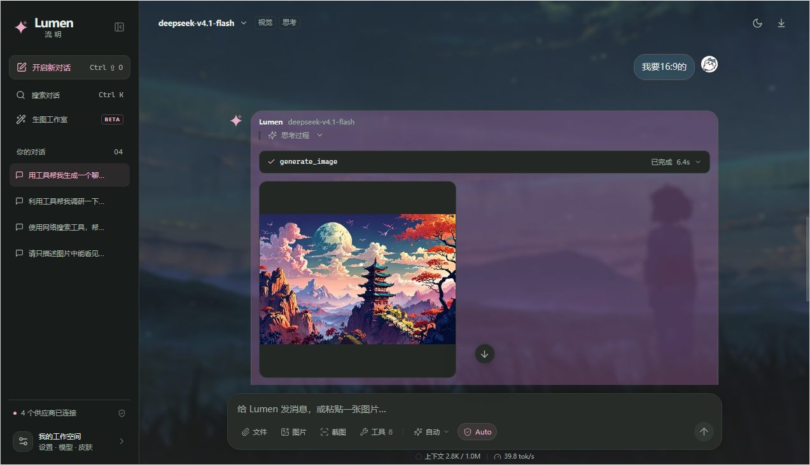
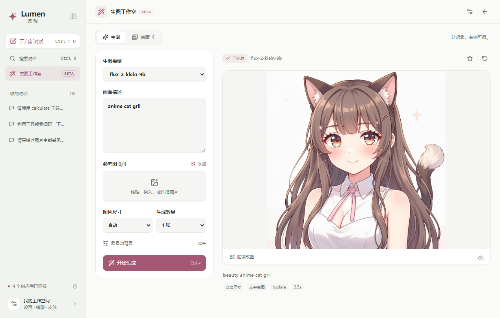
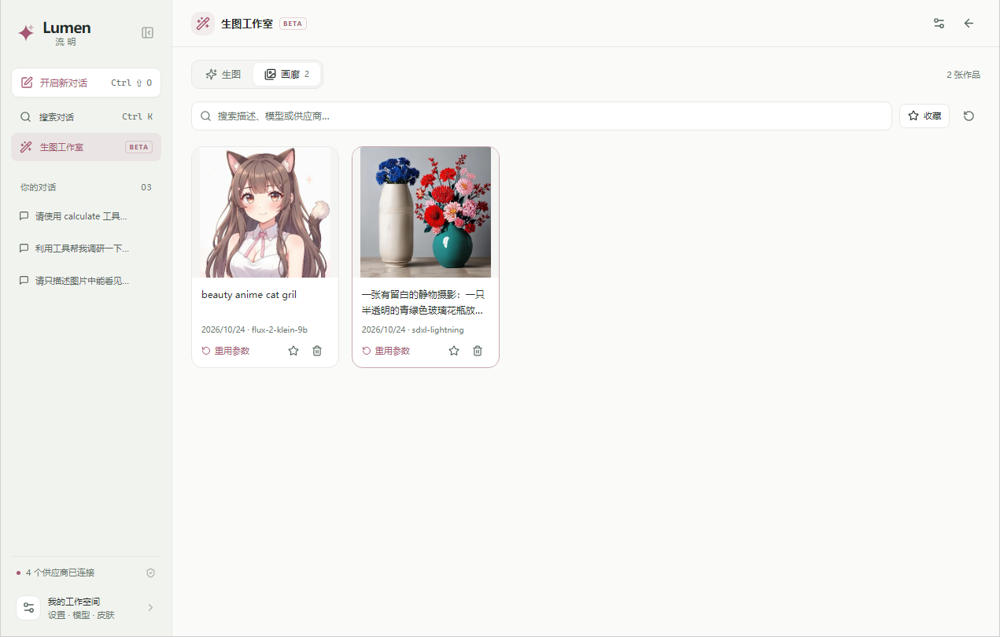
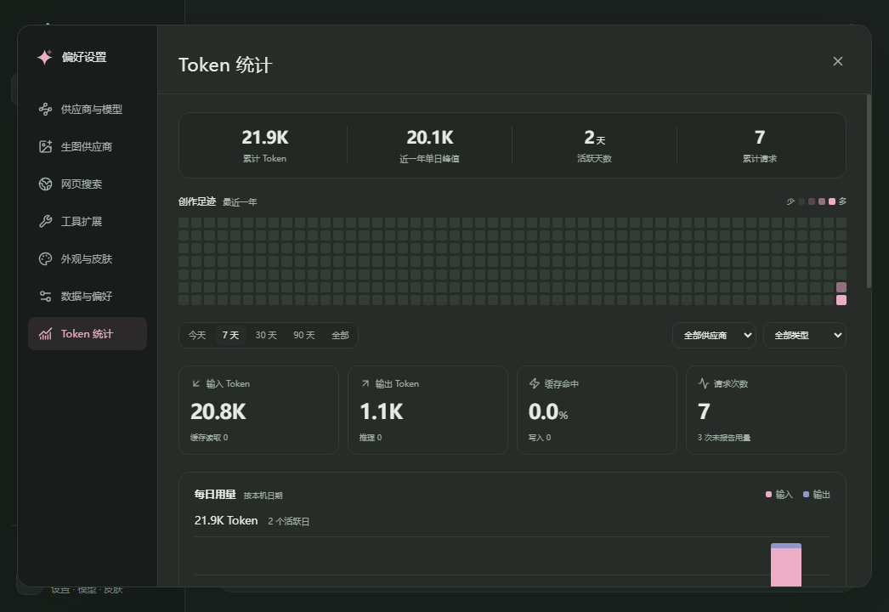

# Lumen · 流明｜市场发布资料

本文件仅供本地开发和准备市场资料，不同步到公开仓库。文案对应当前 0.2.4 Beta，展示图来自用户提供的实际界面截图。

## 名称

Lumen · 流明

## 简介

轻量的 uTools AI 工作空间，支持多模型 Agent、图片聊天、生图画廊、联网搜索与用量统计。

## 详细介绍（可直接粘贴）

Lumen · 流明，把聊天、工具和生图放进 uTools。

连接自己的模型，粘贴文字或图片开始对话；让 Agent 搜索、计算、读取附件或生成图片，把作品保存在本地画廊。Lumen 采用 BYOK 方式，使用你自己的供应商、API 地址和密钥，安装后即可运行。

当前版本：**0.2.4 Beta**。uTools 插件市场审核中。

开源地址：[https://github.com/Saktawdi/utools-lumen](https://github.com/Saktawdi/utools-lumen)

### 自己的模型，自由切换

- 支持 OpenAI Chat、OpenAI Responses、Anthropic Messages 和 Google Gemini 四种聊天协议。
- 一键拉取模型，支持文本筛选、复选、筛选结果全选和拖动框选，常用模型加入启动列表后可在聊天顶部切换。
- 自动匹配视觉输入、工具调用、上下文与推理参数，兼容供应商前缀、命名空间、日期和推理档位后缀，也可手动覆盖。
- 推理强度支持自定义；配置档位可用中英文逗号、分号或回车分割，支持多行粘贴。
- 聊天、生图与搜索服务的多个密钥均可批量导入、去重、轮询和失败切换。

### 图片对话与 Agent 工具

- 图片支持粘贴、拖放、选图和截图，也可以添加文本及代码附件。
- 展示流式回复、思考过程和工具执行状态；支持停止、重试、编辑重发与历史搜索。
- 内置工具发现 `list_tools`、时间、计算、网页搜索、网页读取、附件发现和读取，支持注册更多本地或 HTTP 工具。
- 搜索可接入 AnySearch 官方 MCP、Tavily、SearXNG 或自定义 JSON 服务，配置页可直接测试。
- 输入框内单击切换「每次询问 / Auto」：默认逐次确认需授权的调用，Auto 自动允许。切换即时生效并记住选择，关闭的工具保持关闭。

### 生图工作室与本地画廊

- 侧栏提供独立「生图工作室」，包含「生图」和「画廊」两个页面。
- 在「生图供应商」单独管理连接，支持 OpenAI Images 兼容接口和 Google Gemini 原生生图接口，也可复制已有聊天供应商的连接。
- 输入画面描述生成图片，或粘贴、拖放参考图继续改图；按模型支持的能力设置尺寸、数量、质量与背景。
- Agent 也可调用 `generate_image`，使用同一套生图配置与工具权限模式。
- 作品自动进入本地画廊，支持搜索、收藏、预览、复制、下载、重用参数和继续改图。

### 看得见的上下文与用量

- 聊天输入框下方一行显示上下文占用环形图和 `tok/s` 输出速率，悬停查看详细数值；上下文估算值会明确标记。
- 「偏好设置 → Token 统计」集中查看累计 Token、最近一年活动热力图、每日趋势、模型分布与最近请求。
- 支持按时间、供应商和聊天／生图类型筛选，并导出 CSV。
- 历史用量来自供应商回报，未报告的请求会明确标记；删除聊天或作品后仍可查看历史统计。

### 让聊天空间更合自己的习惯

- 浅色、深色、跟随系统，内置青岚、远山、暖砂和绯雾四款皮肤。
- 自定义本地背景，调整高斯模糊、图片显隐和位置；独立设置浅深色配色。
- 柔和、描边、简约气泡，可调圆角与不透明度；支持双侧或单侧聊天布局，默认用户在右。
- 用户和 Agent 的头像均支持本地图片；皮肤可通过 JSON 导入导出。
- 紧凑布局同步收紧气泡、消息和段落间距，预览即时响应；可减少动态效果，设置自动保存。
- 支持对话置顶、重命名、Markdown 导出以及配置与会话 JSON 备份恢复。

### 随手翻译与问答

- **AI翻译**：选中文字交给默认 Agent 翻译，目标语言可设，默认简体中文。
- **AI截图翻译**：框选区域，截图复制到剪贴板并自动发送翻译；需要支持图片的默认模型。
- **AI问答**：选中文字，快速发起咨询。

### 开始使用

1. 在 uTools 搜索「Lumen」或「流明」，进入左下角「我的工作空间」。
2. 在「供应商与模型」添加 API 地址和密钥，选择对应协议。
3. 拉取模型并勾选常用模型，返回聊天即可使用。
4. 按需配置「生图供应商」「网页搜索」，在「数据与偏好」设置默认 Agent、翻译目标语言和发送方式。

模型、图片与工具能力取决于你选择的服务，所需额度及费用由相应服务商决定。会话、配置和作品保存在本机；聊天、生图、搜索与工具请求会发送到对应的服务或工具地址。头像和背景属于本地外观设置，不作为聊天附件发送给模型。Lumen 无自有遥测或中转服务。

## 展示图片

四张展示图已整理到工程根目录 `assets/screenshots/`，与 README 共用；不放入插件的 `public/`，避免增加安装包体积。上传时以 uTools 发布页面的尺寸、格式和数量要求为准。

| 建议顺序 | 文件                                                       | 展示重点                                                           |
| -------- | ---------------------------------------------------------- | ------------------------------------------------------------------ |
| 1        | [agent-chat.png](../assets/screenshots/agent-chat.png)     | 多模型 Agent、工具生图、自定义背景、头像、权限切换与会话实时统计。 |
| 2        | [image-studio.png](../assets/screenshots/image-studio.png) | 浅色生图工作室，模型、画面描述、参考图、参数与实际生成结果。       |
| 3        | [gallery.png](../assets/screenshots/gallery.png)           | 本地画廊，作品搜索、收藏与参数重用。                               |
| 4        | [token-usage.png](../assets/screenshots/token-usage.png)   | 深色 Token 统计、累计用量、活动热力图与每日趋势。                  |

### 1. 聊天与 Agent 生图

配图说明：粘贴图片、调用工具、切换模型，把生成的作品留在聊天里。

### 2. 生图工作室

配图说明：选择自己的生图模型，用文字或参考图继续创作。

### 3. 本地画廊

配图说明：搜索、收藏、下载作品，一键重用参数或继续改图。

### 4. Token 统计

配图说明：查看累计用量、每日趋势与最近一年的活动。

本次三张 Token 统计附件内容相同，已整理为一份展示素材。

## 本地发布备注

在「uTools 开发者工具」的插件应用发布页面填写名称、简介、详细介绍并上传展示图；上方“详细介绍”可整段复制，包含开源地址。当前为 0.2.4 Beta，uTools 插件市场仍在审核；GitHub 提供 Beta 预发行版与本地导入包。开发模式下的超级面板等入口受宿主限制。

公开源码使用独立目录 `.local/github-public` 管理，发布时沿用排除 `docs/`、本地配置、验证数据和密钥的规则；此文件及其他本地开发文档不进入公开提交。
